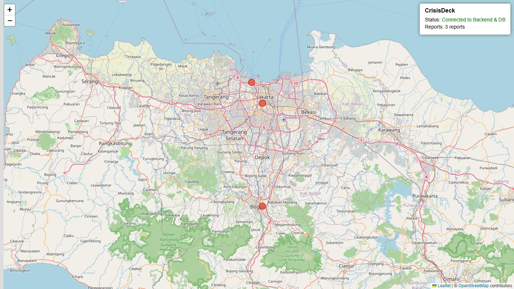

<div align="center">

# TDMRC Disaster Dashboard

**A field-ready disaster reporting dashboard — Node.js, PostgreSQL and Nginx, packaged with Compose.**

[](https://github.com/Zahrexxs/tdmrc-disaster-dashboard/actions/workflows/ci.yml)


Serves a Leaflet map, a health API and a static dashboard, with security headers,
graceful shutdown and a database healthcheck built in.

</div>

---

## Contents

- [Overview](#overview)
- [Preview](#preview)
- [Architecture](#architecture)
- [Quick start](#quick-start)
- [Configuration](#configuration)
- [API](#api)
- [Testing](#testing)
- [Project structure](#project-structure)
- [Production deployment](#production-deployment)
- [Hardening](#hardening)
- [Troubleshooting](#troubleshooting)
- [Further reading](#further-reading)
- [License](#license)

## Overview

The TDMRC Dashboard is the deployment layer for a disaster-mitigation centre. It
is designed to run on a single VPS or an offline field server and to be brought up
with one command:

```bash
docker compose up -d --build
```

It gives you:

- a Leaflet map that plots recent reports as markers with popups
- `GET /api/health` for load balancers and container healthchecks
- `GET/POST /api/reports` for reading and creating reports
- PostgreSQL persistence with a seeded `reports` table
- Nginx in front of the app, with gzip, security headers and proxy headers
- optional pgAdmin, enabled only when you ask for it

## Preview



The dashboard loads up to 100 recent reports from `GET /api/reports` and plots
each located report as a marker. Popups show the title, description, victim
count and timestamp. Report fields are HTML-escaped before rendering.

## Architecture

```
Browser
   │
   ▼
Nginx :80 ──── static + reverse proxy
   │
   ▼
Express :3000 ── /api/health, dashboard, security middleware
   │
   ▼
PostgreSQL :5432 ── reports table (lat/long, victims, timestamps)
```

See [ARCHITECTURE_AND_OFFLINE.md](./ARCHITECTURE_AND_OFFLINE.md) for the full
diagram and offline map-tile strategies.

## Quick start

**Requirements:** Docker + Docker Compose.

```bash
git clone https://github.com/Zahrexxs/tdmrc-disaster-dashboard.git
cd tdmrc-disaster-dashboard

cp .env.example .env
# edit .env and set a strong POSTGRES_PASSWORD

docker compose up -d --build
```

| Service | URL |
|---|---|
| Dashboard | <http://localhost> |
| API health | <http://localhost/api/health> |
| pgAdmin (optional) | <http://localhost:5050> |

pgAdmin is not started by default. Enable it with:

```bash
docker compose --profile tools up -d
```

## Configuration

All settings come from `.env`:

| Variable | Default | Description |
|---|---|---|
| `PORT` | `3000` | HTTP port the app listens on |
| `POSTGRES_USER` | — | Database user |
| `POSTGRES_PASSWORD` | — | Database password (set a strong value) |
| `POSTGRES_DB` | — | Database name |
| `POSTGRES_HOST` | `db` | Database host |
| `POSTGRES_PORT` | `5432` | Database port |
| `CORS_ORIGIN` | _disabled_ | Comma-separated list of allowed browser origins |
| `PGADMIN_EMAIL` | — | pgAdmin login, only used with the `tools` profile |
| `PGADMIN_PASSWORD` | — | pgAdmin password, only used with the `tools` profile |

## API

### `GET /api/health`

```json
{
  "status": "ok",
  "timestamp": "2026-01-01T00:00:00.000Z",
  "database": "connected",
  "db_time": "2026-01-01T00:00:00.000Z"
}
```

| Case | Status | Body |
|---|---|---|
| Database reachable | `200` | `status: "ok"` |
| Database unreachable | `500` | `status: "error"`, `database: "disconnected"` |
| Unknown `/api/*` route | `404` | `{ "error": "Not found" }` |

Database error details are logged server-side and never returned to the client.

### `GET /api/reports`

Returns the most recent reports, newest first.

| Query | Default | Description |
|---|---|---|
| `limit` | `50` | Integer between 1 and 100 |

```json
{
  "reports": [
    {
      "id": 1,
      "title": "Flood in Jakarta",
      "description": "Severe flooding in downtown area",
      "latitude": -6.2,
      "longitude": 106.816666,
      "victims": 120,
      "created_at": "2026-01-01T00:00:00.000Z"
    }
  ],
  "count": 1
}
```

### `POST /api/reports`

Creates a report.

```json
{
  "title": "Flood in Jakarta",
  "description": "Severe flooding in downtown area",
  "latitude": -6.2,
  "longitude": 106.816666,
  "victims": 120
}
```

| Field | Required | Rules |
|---|---|---|
| `title` | yes | string, 1–255 characters (trimmed) |
| `description` | no | string, up to 5000 characters |
| `latitude` | yes | number, −90 to 90 |
| `longitude` | yes | number, −180 to 180 |
| `victims` | no | integer, 0 to 1,000,000 (default 0) |

Returns `201` with `{ "report": { ... } }`, or `400` with
`{ "error": "Validation failed", "details": [...] }`.

## Testing

```bash
npm ci
npm test
```

Tests use `node:test` and inject a stub database, so no PostgreSQL instance is
needed. CI runs the same command on every push and pull request.

## Project structure

```
src/
  app.js             Express app factory (middleware, routes, error handling)
  reports.js         Reports API router and validation
  server.js          Bootstrap: listen, DB check, graceful shutdown
public/
  index.html         Dashboard shell
  app.js             Map, report markers and health-check client
  reports-view.js    XSS-safe report popup rendering
  app.css            Layout and panel styles
config/
  db.js              PostgreSQL pool
test/
  health.test.js     API and routing tests
docker/
  nginx/             Reverse-proxy config
  postgres/          Init SQL
```

## Production deployment

**Prerequisites:** Ubuntu 22.04, Docker, Docker Compose.

```bash
sudo apt update && sudo apt upgrade -y
sudo apt install docker.io docker-compose-plugin -y
sudo systemctl enable --now docker

sudo ufw allow 22/tcp
sudo ufw allow 80/tcp
sudo ufw allow 443/tcp
sudo ufw enable
```

Deploy:

1. Copy the repository to `/var/www/tdmrc`.
2. Set `NODE_ENV=production` and a strong `POSTGRES_PASSWORD` in `.env`.
3. Run `docker compose up -d --build`.

### HTTPS

For a real domain, install Certbot on the host:

```bash
sudo apt install certbot python3-certbot-nginx
```

Since Nginx runs inside Docker, either run Certbot with the webroot plugin, use a
dedicated sidecar, or put Nginx on the host and proxy to `localhost:3000`.
`nginx-proxy` + `acme-companion` is the lowest-effort option for automatic SSL.

## Hardening

- **Rate limiting** — 100 requests / 15 minutes per IP on `/api`.
- **Security headers** — Helmet with an explicit Content-Security-Policy that
  allows Leaflet from `unpkg.com` and tiles from OpenStreetMap only.
- **Proxy awareness** — trusts exactly one proxy hop so the real client IP is
  used for rate limiting behind Nginx.
- **CORS** — disabled by default; opt in with `CORS_ORIGIN`.
- **Graceful shutdown** — `SIGTERM`/`SIGINT` close the HTTP server and the pool,
  with a 10-second force-exit safety net.
- **Non-root container** — the app runs as `appuser`, not root.

### Backups

```bash
# Backup
docker exec -t tdmrc_db pg_dumpall -c -U tdmrc_user > backup_$(date +%F).sql

# Restore
cat backup_file.sql | docker exec -i tdmrc_db psql -U tdmrc_user -d tdmrc_db
```

## Troubleshooting

| Symptom | Likely cause | Fix |
|---|---|---|
| `docker compose` warns about `version` | Old Compose file | Already removed in this repo |
| App container restarts repeatedly | Database not ready / wrong credentials | Check `docker compose logs db` and `.env` |
| Dashboard loads but status is red | API cannot reach PostgreSQL | Check `docker compose logs app` |
| Port 80 already in use | Another web server is running | Stop it, or remap `nginx` ports |

## Further reading

- [ERD.md](./ERD.md) — database schema
- [ARCHITECTURE_AND_OFFLINE.md](./ARCHITECTURE_AND_OFFLINE.md) — architecture and offline tile caching

## License

[MIT](./LICENSE) © 2026 Muhammad Naufal Azzahri
